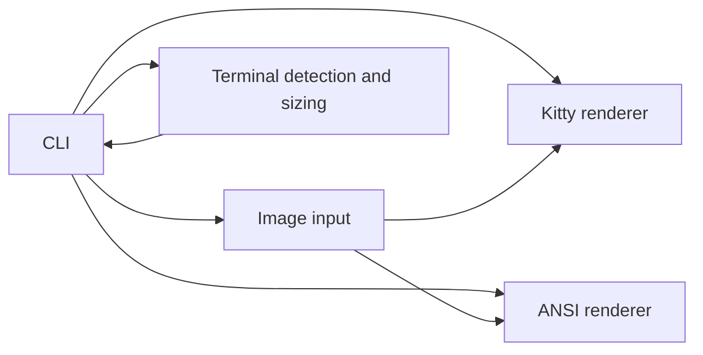

# Bors

Bors displays PNG, JPEG, and GIF images directly in a terminal. It uses the Kitty Graphics Protocol when automatic capability detection confirms support and otherwise draws ANSI-colored Unicode blocks.

## Contents

- [Build and install](#build-and-install)
- [Usage](#usage)
- [Options](#options)
- [Rendering behavior](#rendering-behavior)
- [Supported formats and limitations](#supported-formats-and-limitations)
- [Architecture](#architecture)
- [Project structure](#project-structure)
- [Development](#development)

## Build and install

Requires Go 1.27.2 or later, Meson 1.2 or later, and Ninja.

```sh
git clone https://github.com/kristyancarvalho/bors.git
cd bors
meson setup build
meson compile -C build
./build/bors ~/Pictures/photo.png
```

Meson installs the binary using its configured prefix. To install under `~/.local`:

```sh
meson setup build --prefix="$HOME/.local"
meson compile -C build
meson install -C build
```

On Arch Linux, build and install the package from a public tagged source release with `makepkg -si`. The root `PKGBUILD` builds and tests the source through Meson.

Meson can run Bors with configured arguments. The option accepts a comma-separated argument list:

```sh
meson configure build -Drun_args=--fallback,/path/to/photo.png
meson compile -C build run
```

For arbitrary arguments, invoke `./build/bors` directly after compiling.

## Usage

```sh
bors ~/Pictures/photo.png
bors -s 80x24 ./screenshot.jpg
bors --fallback -s 80x24 ./photo.png
bors --kitty ./photo.png
cat photo.png | bors -
```

Bors accepts one path per invocation. Use `-` for stdin and `--` before a path that begins with a dash. Standard output must be an interactive terminal so image escape sequences are not written into a file or pipe.

## Options

| Option | Behavior |
| --- | --- |
| `-h`, `--help` | Print usage and available options. |
| `--version` | Print the build version. |
| `-f`, `--fallback` | Force ANSI blocks and skip Kitty detection. |
| `--kitty` | Force Kitty Graphics Protocol output. |
| `-s`, `--size SIZE` | Maximum terminal-cell dimensions: `80x24`, `80`, or `x24`. |
| `-r`, `--resolution 1\|2` | Fallback rows per cell; defaults to 2 when the locale indicates UTF-8, otherwise 1. |
| `--color auto\|truecolor\|256` | Select ANSI colors. `auto` uses truecolor for `COLORTERM=truecolor` or `24bit`, 256 colors for a `TERM` ending in `256color`, and 16 colors when capabilities are unknown. |

The size is a maximum in terminal cells. Bors preserves the displayed image proportions using the terminal cell aspect ratio when available. A missing width or height uses the corresponding terminal dimension.

## Rendering behavior

Automatic mode first requires an interactive stdout. When stdin and stdout are terminals, Bors uses the Kitty query action and DA1 response to identify Kitty Graphics Protocol support. A positive response selects Kitty; no response, unsupported output, or non-terminal stdin selects ANSI. Forced modes do not switch renderers.

The Kitty renderer transmits PNG data directly in base64 chunks and converts JPEG/GIF input to PNG. It places the image in a cell-sized rectangle and lets the terminal advance the cursor after placement. The ANSI renderer uses upper-half blocks at resolution 2 and solid blocks at resolution 1; when the locale does not indicate UTF-8, resolution 1 uses the ASCII `#` glyph. ANSI output is an approximation: its appearance varies with fonts, color support, terminal cell geometry, and color palette. Transparent pixels are composited against black because the default terminal background cannot be queried reliably.

## Supported formats and limitations

- PNG, JPEG, and GIF are accepted. GIF frames are composited with their disposal rules and frame delays. Kitty uses terminal animation support; ANSI redraws frames in place. Infinite GIFs keep the ANSI process running until interrupted.
- Input is limited to 64 MiB; decoded images are limited to 32,768 pixels per side and 40 million pixels total. Multi-frame GIF compositing is limited to 20 million full-frame pixels in total to bound memory use.
- Kitty output requires a terminal that supports Kitty Graphics Protocol. Bors does not infer support from `TERM` alone.
- Kitty animated GIF playback requires the terminal's Kitty animation support, introduced in Kitty 0.20. Automatic capability detection confirms graphics protocol support but does not check animation support.
- Automatic Kitty detection is skipped when stdin is not a terminal, including when image data is piped to `bors -`.
- The ANSI renderer uses ANSI color sequences with Unicode blocks by default and ASCII `#` for resolution 1 when UTF-8 is unavailable. Its output is not pixel-identical to the source image.
- The project is distributed under the [MIT License](LICENSE).

## Architecture



## Project structure

```text
cmd/bors/       CLI entry point
internal/       CLI, input, terminal, and renderer packages
tests/          Automated behavior and protocol tests
meson.build     Build, install, test, and run targets
PKGBUILD        Arch Linux source package
```

## Development

```sh
gofmt -w $(rg --files -g '*.go')
go test ./...
go test -race ./...
go vet ./...
go build ./...
```

Meson provides the same build and quality checks through its normal targets:

```sh
meson setup build
meson compile -C build
meson test -C build --print-errorlogs
```

Automated protocol tests use fake terminal transports and validate emitted sequences. They do not establish compatibility with a real terminal emulator. Manual visual checks in Kitty-compatible and non-Kitty terminals remain separate from the automated test suite.
